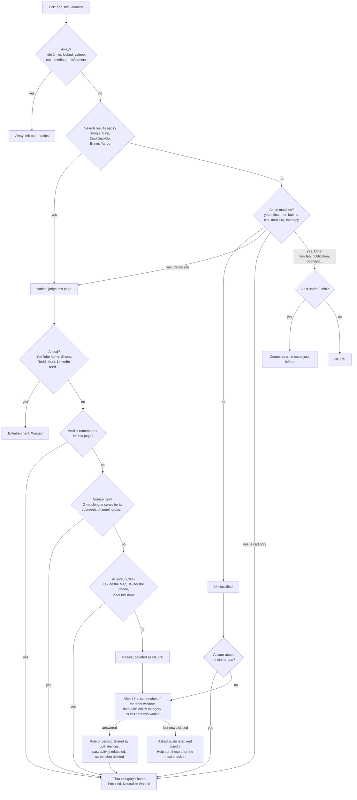
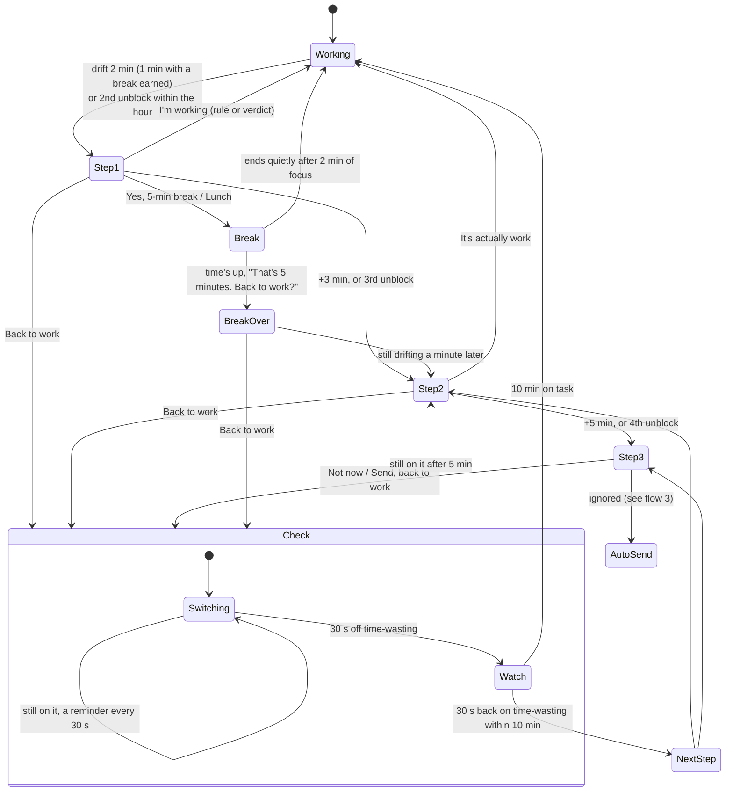
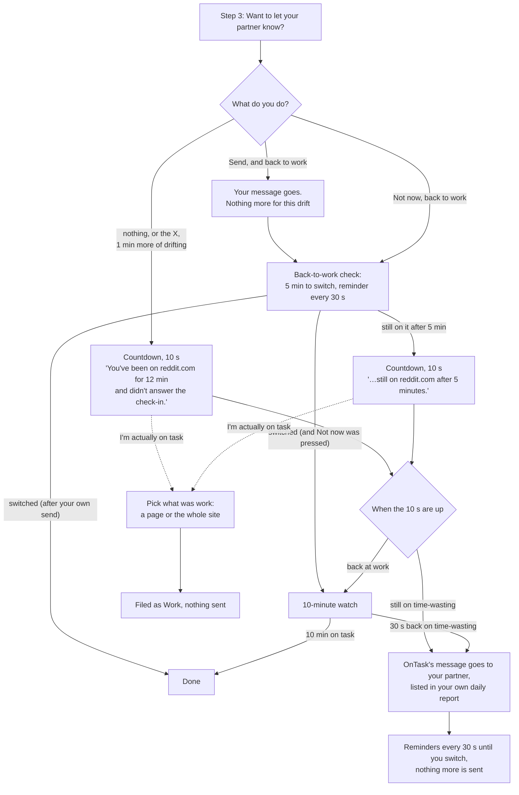
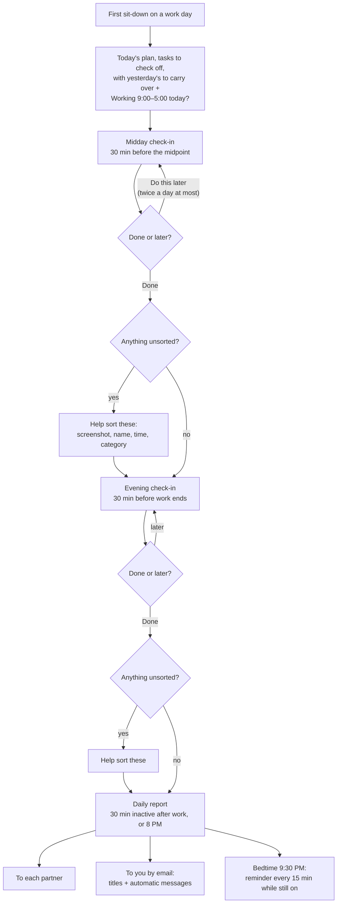
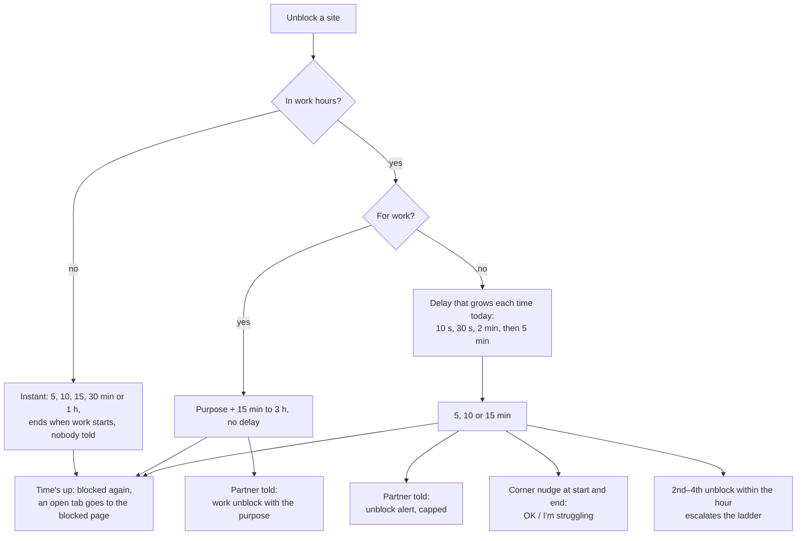
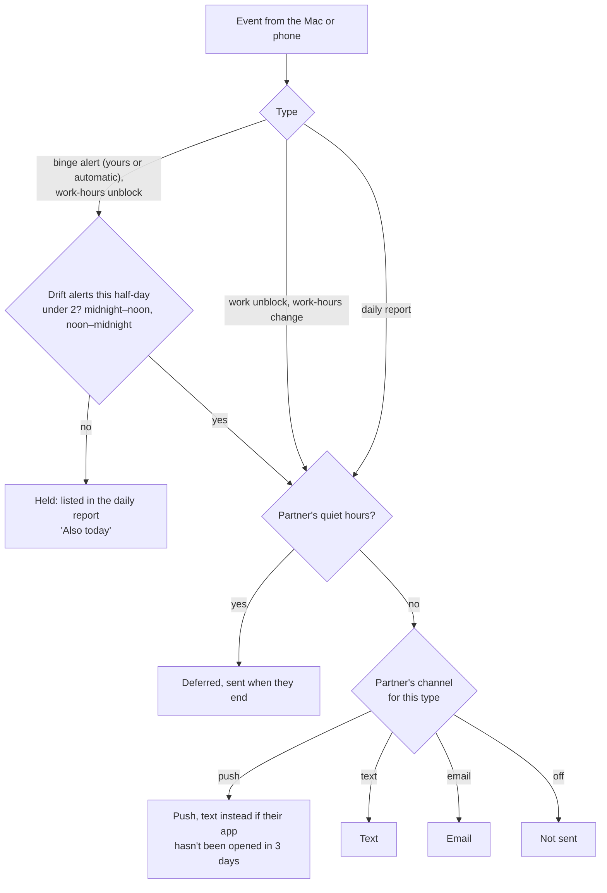
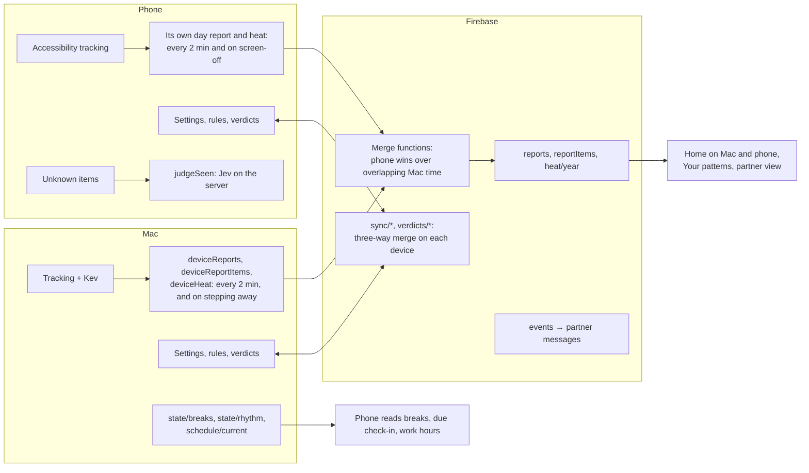

# OnTask — Flows

Diagrams of how OnTask decides and acts. [DESIGN.md](DESIGN.md) has the full rules and
[DECISIONS.md](DECISIONS.md) the reasons. **Keep these current:** a change to one of these flows updates its diagram in
the same commit. GitHub draws the Mermaid blocks; any Mermaid viewer works offline.

1. [How a category is decided](#1-how-a-category-is-decided)
2. [Drift prompts (the ladder)](#2-drift-prompts-the-ladder)
3. [Telling your partner when step 3 is ignored](#3-telling-your-partner-when-step-3-is-ignored)
4. [The daily rhythm](#4-the-daily-rhythm)
5. [Unblocking a site](#5-unblocking-a-site)
6. [Partner messages](#6-partner-messages)
7. [Mac and phone sync](#7-mac-and-phone-sync)

---

## 1. How a category is decided

Every tick (a few seconds on the Mac, 5 s on the phone) the app, window title and address in front are classified.

- Timings: unclassified question after 15 s; at most once per page and every 2 minutes; Not now = 15 min; closing
  with the X = 1 min. Screenshots are kept on the device that took them, at most 7 days.
- Changing a category anywhere (timeline pop-up, Where the time went, Help sort these) makes the same rule or verdict.
- A browser window with no readable address is named from its title ("Google Chrome – Gmail"); its rule covers only
  that browser's windows with that title.

---

## 2. Drift prompts (the ladder)

In work hours (and on work days, before work hours, once the morning plan is done). A site you unblocked
outside work hours isn't drifting while the unblock lasts. Drift = time actually on a Wasted category: a minute back
at work or away pauses it; a minute off ends it.

- **Earned breaks:** 5 min per 25 focused (at most 10 under an hour, 15 after); unfocused time is taken off minute
  for minute. **Lunch:** 11–2, once a day, "Is lunch over?" at 30 min, 15 more allowed, 45 max.
- **Picking up where it left off:** a new drift within the hour starts one step higher (second at step 2, third at
  step 3).
- Closing a prompt with its X brings it back after 30 s. Nothing on a prompt makes you wait.
- Before work hours, step 3 is the step-2 window again (no partner). On the phone: step 1 is a notification, steps
  2–3 full screen; Back to work goes to the home screen.

---

## 3. Telling your partner when step 3 is ignored

Work hours, with a partner. At most one message per drift, and the server's cap applies (flow 6).

- *I'm back to work* and the X only close the countdown window; what you do next decides.
- On the phone the countdown is full screen, and the screen being off isn't drifting.

---

## 4. The daily rhythm

Anchored to your first sit-down on a work day. Check-ins appear on the device in use (the phone after 5 minutes
away from the Mac).

- Skipped sorting comes back in the next check-in (today's and yesterday's items).
- The plan's tasks can be checked off all day: Home, both check-ins and every nudge. Start my day starts the day.
- The midday check-in's "What's in the way?" chips appear only after a struggling morning.

---

## 5. Unblocking a site

The block list is blocked around the clock; work hours only change how hard it is to unblock.

---

## 6. Partner messages

Devices only write events; Cloud Functions send everything.

- Drift messages end with "No need to reply — but a 👍 helps." Partners can react with one tap; reactions reach the
  Mac and the phone.
- Automatic messages are also recorded for your own daily report.

---

## 7. Mac and phone sync

- Raw activity and screenshots never leave the device; only day reports, settings, verdicts and events do.
- A break or lunch started on either device is shared through `state/breaks`; check-ins answered on the phone go to
  `phoneCheckins/{date}` and the Mac takes them as done.
